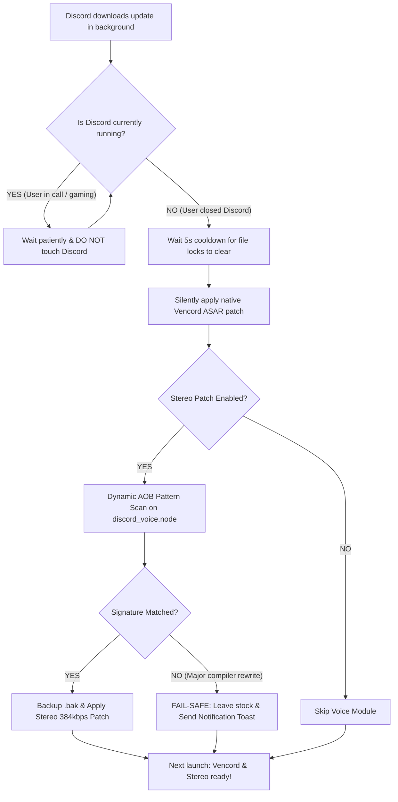

# 🎧 Vencord Graceful Patcher (+ True Stereo Voice Engine + FakeDeafen+)

[](https://www.python.org/)
[](https://microsoft.com)
[](LICENSE)
[](https://discord.com)

> **The Discord-friendly auto-patcher for Vencord and True Stereo Audio.**  
> Automatically re-patches Vencord and restores high-fidelity stereo voice transmission through Discord updates — **without ever force-closing Discord mid-call or crashing on new builds.**

---

## 🚫 The Problem with Existing Updaters

Other community auto-patchers and audio installers (such as `BetterVencordPatch` and `Stereo.Installer`):
1. **Forcefully kill Discord:** Run `taskkill /F /IM Discord.exe` mid-game or mid-call the second an update downloads.
2. **Crash on New Builds:** Overwrite your local `discord_voice.node` with outdated binary dumps from months ago, causing Discord to crash on launch or get stuck in the infinite **"RTC Connecting..."** voice loop.
3. **Fail on Minor Updates:** Rely on fixed memory offsets that break the moment Discord updates.

---

## ✨ How Vencord Graceful Patcher Works



1. **Monitors Updates Silently:** Watches for newly downloaded Discord version folders (`app-1.0.xxxx`).
2. **Never Drops Calls:** If you are actively using Discord, it **never touches your process**.
3. **Patches When Closed:** The moment you close Discord or shut down your PC, it safely applies the Vencord patch and scans the voice engine.
4. **Dynamic AOB Voice Scanning:** Searches your *own local* `discord_voice.node` for machine code instructions to enable 2-channel stereo and 384kbps studio bitrate.
5. **Fail-Safe Protection:** If a major Discord update changes the voice engine assembly, it refuses to touch the file and alerts you via a native notification toast, ensuring Discord **never crashes**.
6. **Keeps FakeDeafen+ Alive:** Vencord's own updater replaces `renderer.js`; the service notices within seconds and re-adds FakeDeafen+ so it is ready on your next Discord start.

---

## 🚀 Features

* ⚡ **100% Standalone & Native:** Does **not** require the Vencord installer. It builds the byte-exact Electron ASAR loader in Python, and downloads Vencord's official desktop build (`patcher.js`, `preload.js`, `renderer.js`, `renderer.css`) straight from GitHub if you have never installed Vencord.
* 🎙️ **True Stereo & High Bitrate:** Bypasses Discord Desktop's native mono downmixer and Opus 1-channel lock, enabling true 2-channel 384kbps audio. A stock `.bak` backup is always kept.
* 🎧 **FakeDeafen+:** Appear deafened and muted to everyone else while you still hear and talk. Button in the call toolbar next to the microphone, or press **F8** / **Ctrl+Shift+Q**. Auto-deactivates when you switch channels.
* 🛡️ **Fail-Safe Reliability:** If an update isn't recognized, Discord runs safely in stock mode instead of breaking, and you are told once (not every reboot).
* 📞 **Zero Voice Call Interruptions:** Never terminates your Discord session while you are active.
* 📦 **Zero External Dependencies:** Built entirely with Python's standard library (no `pip install` required).
* 🔕 **100% Invisible Background Execution:** Runs via `pythonw.exe` without command prompt popups. Only one instance can ever run.
* 🔄 **Multi-Branch Support:** Automatically monitors **Discord Stable**, **PTB**, **Canary**, and **Development**, and never blocks one branch because another is open.
* 🔔 **Native Windows Toast Notifications:** Alerts you when an update has been smoothly patched (or if an update needs new signatures).
* ♻️ **Live Config Reload:** Edit `config.json` and the running service picks the change up on its next check.
* 🛠️ **Status & Unpatch Tools:** `status.bat`, `stereo_status.bat`, `stop.bat`, `unpatch.bat`, `stereo_unpatch.bat`, `view_logs.bat`.

---

## 📥 Installation

**Requirements:** Windows 10/11 and [Python 3.8+](https://www.python.org/downloads/) installed with **"Add python.exe to PATH"** ticked. The Microsoft Store Python stub is detected and rejected by the installer.

1. **Clone or Download** this repository:
   ```bash
   git clone https://github.com/sinny999s/VencordGracefulPatch.git
   ```
2. Double-click **`install.bat`**.

That's it! The patcher registers itself in Windows Startup (`shell:startup`), starts immediately, and runs silently in the background. If Discord is closed it patches right away; otherwise it waits until you close Discord.

> Already using Vencord? Nothing changes: the patcher reuses your existing `%APPDATA%\Vencord\dist` files and your settings and plugins stay as they are.

---

## ⚙️ Configuration (`config.json`)

You can customize behavior by editing `config.json`. The running service reloads it automatically.

```json
{
  "check_interval_seconds": 10,
  "cooldown_after_close_seconds": 5,
  "show_notifications": true,
  "enable_stereo_patch": true,
  "enable_fake_deafen": true,
  "relaunch_discord_after_patch": false,
  "monitored_branches": [
    "stable",
    "ptb",
    "canary",
    "development"
  ]
}
```

| Setting | Default | Description |
| :--- | :--- | :--- |
| `check_interval_seconds` | `10` | How often (in seconds, minimum 5) the background service checks for updates. |
| `cooldown_after_close_seconds` | `5` | Wait time after Discord exits before patching (ensures file locks are cleared). |
| `show_notifications` | `true` | Shows a Windows desktop toast when Vencord or Stereo Audio is patched. |
| `enable_stereo_patch` | `true` | Enables dynamic pattern scanning for true stereo and 384kbps audio in `discord_voice.node`. |
| `enable_fake_deafen` | `true` | Keeps FakeDeafen+ injected into Vencord. Set to `false` to remove it automatically. |
| `relaunch_discord_after_patch` | `false` | Automatically restarts Discord after a patch was applied (leave `false` to respect your workflow). |
| `monitored_branches` | `["stable", ...]` | Which Discord release channels to monitor. |

---

## 🎧 Using FakeDeafen+

* Join a voice channel or call, then click the **FakeDeafen+** button next to the microphone in the bottom call toolbar, or press **F8** / **Ctrl+Shift+Q**.
* While active, everyone else sees you as **deafened and muted** and your speaking ring stays hidden, but you keep hearing them and your microphone keeps transmitting.
* Toggle again to go back to your real mute/deafen state. Leaving or switching channels turns it off automatically.
* FakeDeafen+ is added to Vencord's `renderer.js`, so it takes effect the next time Discord starts after installation.

---

## 🔍 Checking Status & Tools

* **Check Overall Status:** Double-click `status.bat` to see the service, Vencord, FakeDeafen+ and voice module state.
* **Check Stereo Engine:** Double-click `stereo_status.bat` to see MD5, pattern matches, and backup status.
* **Stop the Service Temporarily:** Double-click `stop.bat` (it starts again at your next login).
* **Revert Audio to Stock Mono:** Double-click `stereo_unpatch.bat` to restore the original backup. Set `enable_stereo_patch` to `false` first if the service is running, otherwise it will re-apply stereo when Discord is next closed.
* **Restore Discord to Stock:** Double-click `unpatch.bat`. This stops the service, restores the original `app.asar` and voice module, and removes FakeDeafen+ from Vencord.
* **View Logs:** Double-click `view_logs.bat` or inspect `%LOCALAPPDATA%\VencordGracefulPatch\patcher.log`.

Command line equivalents:

```
python patcher.py --status | --check-once | --stop | --unpatch | --daemon
python voice_patcher.py --status | --patch | --unpatch
```

---

## 🧪 Running the Tests

The patch logic is covered by unit tests that run on any platform against synthetic Discord installations:

```bash
python -m unittest discover -s tests -v
```

---

## 🗑️ Uninstallation

Double-click **`uninstall.bat`**. This stops the background service, removes the launcher from Windows Startup, and offers to restore Discord to stock in the same step.

---

## 📄 License

This project is licensed under the [MIT License](LICENSE).
